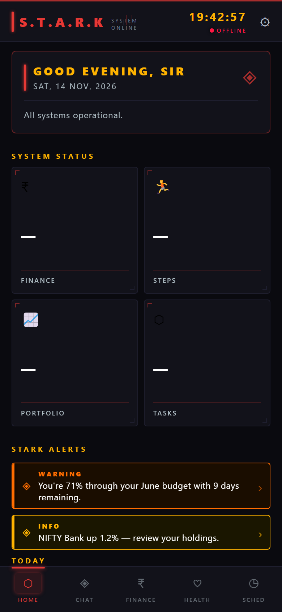
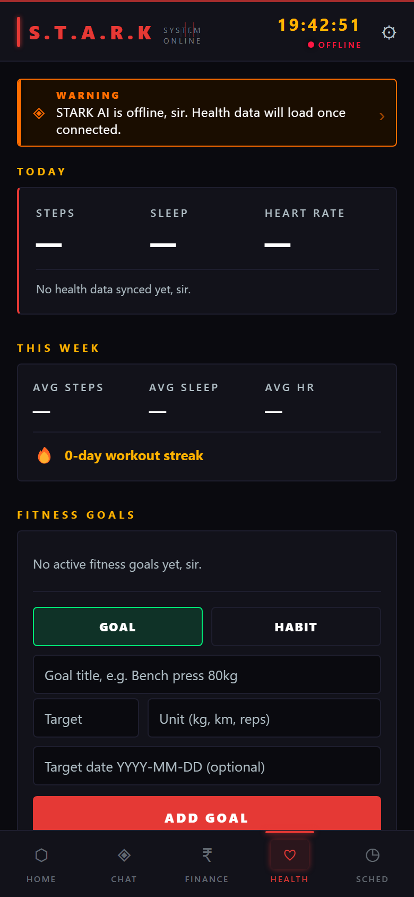

# S.T.A.R.K

**Self-Training Autonomous Reasoning and Knowledge: a personal AI assistant that I am building for myself.**

*Inspired by the assistant from the Iron Man films, and by a lifelong love of the character.*

> **Showcase page.** This is a personal project and is not for sale. The code is proprietary and is not published. See [LICENSE](LICENSE).

## The idea

One assistant that knows my day: my money, my health goals and my schedule. It should help me plan, remember and decide, and keep my personal information private.

## What it aims to do

- **Money:** keep track of spending and goals, and spot patterns.
- **Health and goals:** stay on top of routines and progress.
- **Schedule:** plan the day and send timely reminders.
- **Research:** help me look things up and summarise them.
- **Voice and a heads-up-display style interface:** a sci-fi look, built for a phone.

## Principles

- **Private by design.** My data stays on hardware I control.
- **Useful first.** Practical daily help matters more than flashy demos.

## Screenshots

| Home | Health |
|---|---|
|  |  |

*Captured from the early build with no data connected, so the tiles are empty.*

## Status

In development, as a personal project.

## Skills shown

AI product design · mobile apps · personal data privacy · system design

## Contact

Interested in the idea or want to talk about AI assistants? Message me on [LinkedIn](https://www.linkedin.com/in/abishek-f-151708222).
